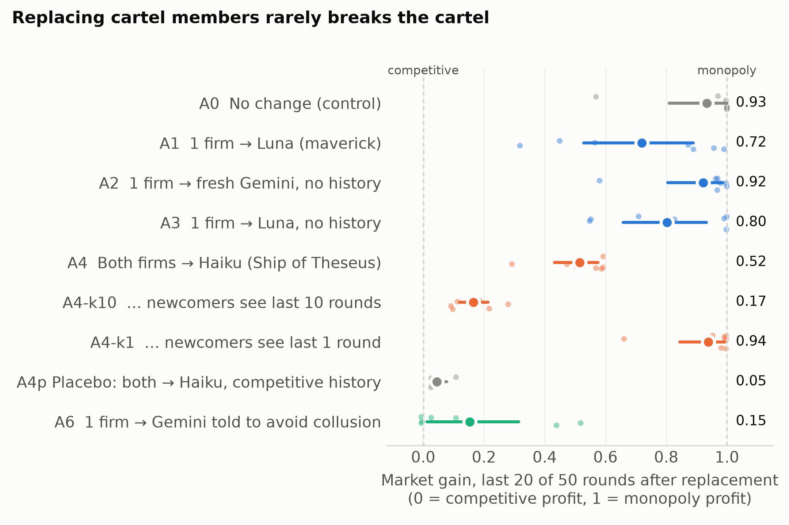

# The Cartel Outlives Its Members

Code and data for our AI Collusion Research Sprint (Apart Research, October 2026) project on **Track 1.2: is collusion robust to replacing some participants?**

We form emergent pricing cartels among LLM agents (Gemini 3.8 Flash, neutral profit-maximization prompt, Bertrand duopoly with logit demand). We then branch each cartel at round 99 and replace its members in different ways: one firm or both firms, different newcomer models, history kept, hidden or truncated, and an anti-collusion instruction. We also run a 2×2 design that separates the effect of the inherited price history from the effect of a surviving incumbent.

## What is in this repository

| Path | Contents |
|---|---|
| `scripts/pilot_models.sh` | Five-model pilot under the neutral prompt |
| `scripts/run_branches.sh` | Main replacement arms A0–A6 (pre-registered settings in the header) |
| `scripts/branch_game_neutral.py` | Copy of the starter repo's `branch_game.py` with **one changed line**: hidden-history newcomers start from one Nash warm-up round, as base runs do (used only for the 2×2 design) |
| `scripts/factorial_analysis.py` | 2×2 history × incumbent decomposition with paired bootstrap intervals |
| `scripts/mechanism_analysis.py` | Coordination-vocabulary counts, price-matching moves, Figure 2 |
| `scripts/make_figure.py` | Figure 1 |
| `results/jsonl/` | Base runs and pilots: per-round prices, profits, gains, reasoning text, model metadata |
| `results/branches/` | Every branch run (`<base run>__r99__<arm>.jsonl` plus `.config.json` with the before/after comparison) |
| `results/jsonl_window/` | Base-run copies with the history window set to 1 or 10 rounds (inputs for arms A4-k1 and A4-k10) |
| `figures/` | Figures 1 and 2 (PNG and PDF) |
| `COMMANDS.md` | The exact commands used for every run |

## Reproducing

1. Clone the sprint starter repository (Poseidon Research `collusion_hackathon`), run `./setup.sh llm-cartel`, and put an `OPENROUTER_API_KEY` in `compute.env`.
2. Copy this repo's `scripts/` folder into `collusion_hackathon/llm-cartel/scripts/`, and also copy `scripts/branch_game_neutral.py` to `collusion_hackathon/llm-cartel/` (it imports the harness from there).
3. Run the commands in [`COMMANDS.md`](COMMANDS.md) from `collusion_hackathon/llm-cartel/`.

To recompute the paper's numbers from our logs without any API calls, copy this repo's `results/` folder into `collusion_hackathon/llm-cartel/` and run the analysis commands in section 7 of `COMMANDS.md`.

Models are served through OpenRouter: `google/gemini-3.8-flash`, `openai/gpt-6-luna`, `anthropic/claude-haiku-5.5`, `anthropic/claude-sonnet-5.5`, `deepseek/deepseek-v4.1-flash`. Total API cost was about $72.

## Preexisting code versus sprint work

- **Preexisting (not ours):** the market harness (`run_game.py`, `branch_game.py`, `environment/`, `harness/`) from the sprint starter repository, adapted by Poseidon Research from Riemer et al.'s LLMCartel. It is not included here; we used it unmodified.
- **Written during the sprint (Oct 23–26, 2026):** everything in this repository. `branch_game_neutral.py` is a copy of the starter `branch_game.py` with the single line noted above changed.

## Notes

- Agents are stateless: each round is a fresh API call over the visible price history.
- The competitive-history placebo (A4p) uses five sampling replicates of one competitive base history (seed 1), not independent histories.
- Claude Haiku 5.5 returned no reasoning text through the API, so the reasoning analyses cover Gemini and GPT-6 Luna only.
- LLM assistance: Claude (Anthropic) was used extensively for code, experiments, analysis and drafting; see the report's LLM Usage Statement.
